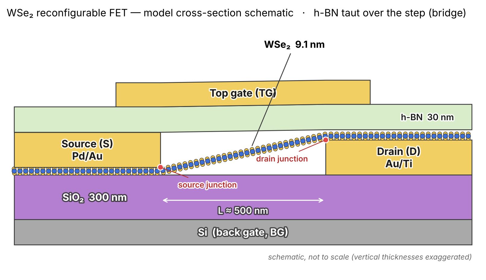

# WSe₂ RFET electrostatics — DEVSIM 독립 구현과 검증

**목표**: Jiao et al., *Appl. Phys. Lett.* **128**, 263504 (2026) 의 "상보적 정전기 차폐(complementary electrostatic shielding)" 기반
WSe₂ 재구성 트랜지스터(RFET, 채널 길이 ≈ 500 nm)를 **처음부터 독립적으로** 모델링하고, 채널 길이를 줄였을 때
Back Gate → Source / Top Gate → Drain 의 선택적 제어가 어디서부터 무너지는지 보는 것이 최종 연구 질문입니다.

이 저장소는 그 첫 단계인 **500 nm 소자의 정전기 모델 구축과 검증(STEP 1–4)** 을 담고 있습니다.
수송(전류)·터널링은 아직 없습니다 (→ [docs/07_next_steps.md](docs/07_next_steps.md)).

> 읽는 순서: 이 README → `docs/00` 부터 번호 순서대로. 각 문서는 "무엇을 했는가"보다 **"왜 그렇게 했는가"** 를 적는 데 중점을 두었습니다.
> 코드 안의 모든 주요 변수에는 `[논문값]` / `[문헌값]` / `[모델 가정]` / `[수치해석 설정]` 태그와 출처가 주석으로 붙어 있습니다.

---

## 한눈에 보는 결과 (실제 gmsh mesh, mesh 수렴 확인됨)

<p align="center"></p>

| 질문 | 답 (bridge 구조, 수렴 mesh) | 근거 |
|---|---|---|
| TG 1 V 는 채널 어디를 움직이는가 | Drain 쪽 junction 옆 10 nm: **0.34 V**, Source 쪽: **0.08 V** | `figures/fig_step3_profiles.png` |
| BG 1 V 는? | Source 쪽 **0.08 V**, Drain 쪽 **0.008 V** | 〃 |
| 밴드 수준에서 상보적 차폐가 보이는가 | TG 는 Drain 위 박막만, BG 는 Source 아래 박막만 움직임 | `figures/fig_step4_bands_bridge_equalmid.png` |
| 수치가 믿을 만한가 | DEVSIM(유한체적) = 독립 FEM = 1D 해석해; mesh 4→6→8 에서 ψ ≤ 0.001 V/V, E_c ≤ 5 meV 변화 | [docs/05_verification.md](docs/05_verification.md) |
| 가장 큰 불확실성 | h-BN 이 단차를 넘는 형상, 접점 Schottky 장벽 높이 | [docs/06_assumptions_and_limits.md](docs/06_assumptions_and_limits.md) |

---

## 저장소 구조

```
README.md                      ← 지금 이 문서
docs/
  00_question_and_principles.md  연구 질문, 지켜야 할 원칙(출처 분류, fitting 금지 등)
  01_parameters.md               STEP 1: 논문에서 확인한 값 / 추가로 정해야 했던 값 (표)
  02_geometry_and_mesh.md        STEP 2: 좌표계, 영역, 두 h-BN 형상, mesh 규칙과 그 이유
  03_electrostatics.md           STEP 3: 유전율 문헌, 선형 Poisson, 단위 응답, 결과
  04_semiconductor.md            STEP 4: 밴드 파라미터 문헌, DOS 모델, Schottky 경계조건, 결과
  05_verification.md             검증 전부: 해석해, DEVSIM vs FEM, mesh 수렴, 실행 로그
  06_assumptions_and_limits.md   모든 가정 목록과 각각이 결과에 주는 영향, 미해결 항목
  07_next_steps.md               STEP 5 이후 계획 (장벽 분석, WKB, scaling)
  08_team_comparison.md          팀원 코드와 비교·실행 결과, 합친 STEP 5-DD 의 설계
  references.md                  인용 문헌 전체 (DOI, 표/그림 위치)
src/
  rfet_geometry.py        2D 단면 geometry (점·다각형), 10가지 기하 검사, 단면도
  rfet_mesh_gmsh.py       gmsh 삼각형 mesh + 크기 규칙 4개 → .msh (nm/cm)
  rfet_mesh_tools.py      .msh 읽기, 단위 변환, mesh 품질 리포트
  rfet_devsim_load.py     DEVSIM 에 mesh 읽기 + 구조 일치 확인
  rfet_size_map.py        mesh 크기 규칙 시각화 (gmsh 불필요)
  rfet_plot_mesh.py       실제 .msh 를 읽어 구조+격자 그림 (fig_mesh_*.png)
  rfet_materials.py       유전율 [문헌값], 스칼라/텐서 선택, ρ=0 가정
  rfet_fem_reference.py   독립 P1 FEM (선형, 스칼라/텐서 ε) + 해석해 selftest
  rfet_poisson_devsim.py  DEVSIM 선형 Poisson (단위 응답 4개)
  rfet_poisson_check.py   DEVSIM 설정을 2층 평행판 해석해로 검증
  rfet_post.py            STEP 3 후처리 (프로파일, 전위 지도)
  rfet_semiconductor.py   밴드갭·전자친화도·유효질량·장벽 [문헌값], 2D-DOS 모델, ρ(ψ)
  rfet_fem_semi.py        비선형 Poisson (Newton) + 1D shooting selftest
  rfet_poisson_semi_devsim.py  DEVSIM 비선형 Poisson
  rfet_post_semi.py       STEP 4 후처리 (밴드 다이어그램, 캐리어)
  rfet_converge_report.py mesh 수렴 리포트
  rfet_transport_devsim.py STEP 5-DD: 드리프트-확산 전류 (우리 모델 + 팀원 DD 레시피 + 2D-DOS 정확 FD)
  rfet_plotstyle.py       그림 공통 스타일 (색 = 의미)
  rfet_schematic.py       발표용 개략도 (비례도 아님)
  run_all.py / run_resume.py / run_converge.py / run_figs.py / run_check.py / run_transport.py   실행 스크립트
figures/                 실제 mesh 결과 그림 (아래 "그림 목록")
results/                 수치 표(txt)와 사용자 PC 실행 로그 3개
```

## 실행 방법 (Windows 기준, 다른 OS 도 같음)

```
cd src
py run_all.py        # venv 생성, pip install devsim gmsh numpy scipy matplotlib, STEP 2→3→4 전체 (10분)
py run_resume.py     # Windows 에서 DEVSIM 이 "math libraries" 오류를 내면: pip install mkl 후 DEVSIM 단계 재실행
py run_converge.py   # mesh 수렴 검사 (N_LAYERS_FILM = 6, 8 로 재계산, 5~10분)
py run_figs.py       # 계산된 .npz 로 모든 그림 재생성 + 해석해 검증
```
- Python 3.11–3.15 에서 확인(3.15.2 로 실제 실행). DEVSIM 2.11.2, gmsh 4.15.2.
- Windows 의 DEVSIM 은 Intel MKL 이 필요합니다 (`pip install mkl`). 첫 실행 로그 `results/run_logs/run_log_1_first_run.txt` 에 그 오류와, 두 번째 로그에 해결이 기록되어 있습니다.
- 모든 스크립트는 `src/` 안에서 실행합니다 (모듈이 서로 import).

## 그림 목록

| 파일 | 내용 |
|---|---|
| `fig_schematic_bridge.png`, `fig_schematic_sag45.png` | 발표용 개략도 (두께 과장) |
| `fig_mesh_bridge.png`, `fig_mesh_sag45.png` | **실제 gmsh mesh** 위에 영역·전극을 그린 구조도 (전체 + source/채널/drain 확대) |
| `fig_geometry_bridge.png`, `fig_geometry_elastic.png`, `fig_geometry_sag45.png` | 정확한 치수의 단면도 (시뮬레이션에 들어간 geometry 그대로) |
| `fig_mesh_size_rules_bridge.png` | mesh 크기 규칙 지도 (어디를 왜 촘촘히 하는가) |
| `fig_step3_profiles.png` | 게이트 1 V 당 채널 전위 응답, DEVSIM(점) vs FEM(선), 구조 변형 비교 |
| `fig_step3_maps_bridge.png` | 전위 응답 2D 지도 + 등전위선 |
| `fig_step4_bands_*.png` | 밴드 다이어그램 (TG/BG sweep): 문헌 장벽 / 장벽 동일 대조군 / sag45 |
| `fig_step4_carriers_*.png` | 캐리어 밀도 |
| `fig_mesh_convergence_bridge.png` | mesh 수렴 (연속 mesh 간 차이, log) |

## 이 작업의 출발점과 원칙 (요약; 전문은 docs/00)

1. 기존 GitHub RFET 코드(팀 저장소 포함)는 **참고만** 하고 구조·구현은 독립.
2. 모든 숫자는 `[A] 논문 직접값` / `[B] 다른 1차 문헌` / `[C] 모델 가정` 으로 분류하고, 확인 안 된 숫자는 넣지 않는다.
3. 단층 WSe₂ 물성을 9.1 nm 다층에 그냥 쓰지 않는다. 이방성 유전율을 스칼라로 쓰면 단순화임을 명시한다.
4. 실험 전류를 fitting 하지 않는다. 임의의 crosstalk 지표를 만들지 않는다 — raw 전위/밴드부터 본다.
5. 모든 수치 결과는 독립적인 두 번째 방법으로 교차 검증한다.
